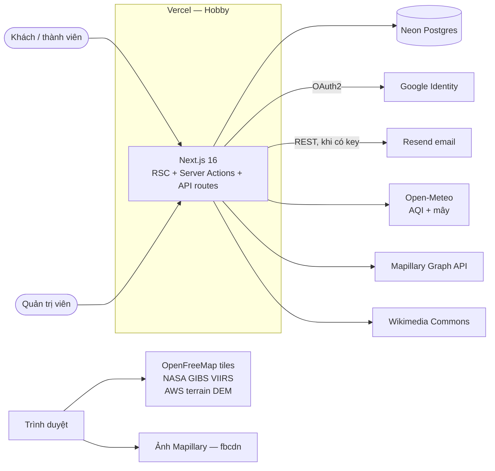
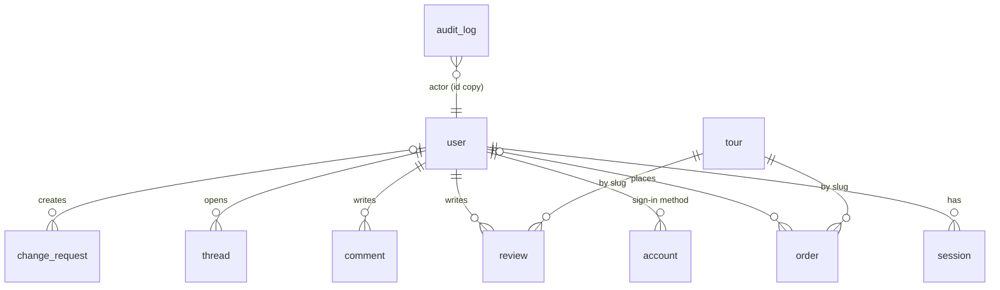
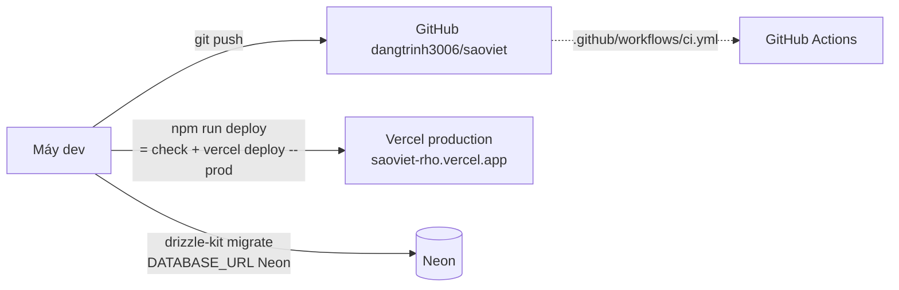

# Kiến trúc hệ thống — Sao Việt

Đọc mã ngày 06/11/2026, commit `126a7d6`, nhánh `main`. Mọi trích dẫn `tệp:dòng` theo commit này.

## 1. Phạm vi

Website du lịch thiên văn song ngữ (vi/en), phi lợi nhuận: danh mục tour/dịch vụ, đặt tour, bản đồ bầu trời tối, ảnh 360°, cộng đồng (đánh giá, bình luận, diễn đàn, blog), tài khoản người dùng và back-office quản trị.

Một ứng dụng Next.js duy nhất (monolith) chứa cả giao diện, server action và API route; một cơ sở dữ liệu Postgres.

## 2. Ngăn xếp

| Lớp | Thành phần | Phiên bản (`package.json`) |
|---|---|---|
| Runtime | Node.js | 24 (CI `setup-node`; máy dev đo 24.11.1). `engines` chưa khai |
| Framework | Next.js App Router, React | 16.4.5 · 19.3.0 |
| i18n | next-intl | ^4.14.9 |
| Xác thực | Better Auth (email/mật khẩu, Google, plugin `admin`) | ^1.7.16 |
| ORM / driver | Drizzle ORM · postgres-js | ^0.45.4 · ^4.0.0 |
| CSDL | PostgreSQL — local Docker `postgres:17-alpine`; production Neon | — |
| Kiểm tra dữ liệu vào | zod | ^4.6.7 |
| Giao diện | Tailwind CSS v4, next-themes, motion | ^4 · ^0.4.6 · ^14.9.1 |
| Bản đồ | MapLibre GL | ^6.16.0 |
| 3D | three, @react-three/fiber, cobe | ^0.187.0 · ^9.8.2 · ^2.0.1 |
| Ảnh 360° | @photo-sphere-viewer/core | ^5.15.1 |
| Thiên văn | astronomy-engine | ^2.1.19 |
| Kiểm thử | Vitest · Playwright | ^5.1.0 · ^1.64.1 |

Font tự host bằng `@fontsource` (Unbounded, Be Vietnam Pro, JetBrains Mono). Không dùng `next/font/google`: mạng phát triển chặn giữa TLS, build sẽ hỏng.

## 3. Ngữ cảnh hệ thống



Tile bản đồ và ảnh Mapillary do **trình duyệt** tải thẳng; các nguồn còn lại do **máy chủ** gọi rồi cache.

## 4. Cấu trúc mã

```
src/
  app/[locale]/        trang theo ngôn ngữ (vi mặc định, en)
    account/           tài khoản, settings/
    admin/             back-office: tours, services, orders, queue, users/[id], audit
    tours/ map/ blog/ forum/ services/ privacy/ terms/ contact/ sign-in/ sign-up/ ...
  app/api/
    auth/[...all]      Better Auth handler
    sky/               AQI + mây, cache 30 phút
    panorama/          tìm ảnh 360° Mapillary/Commons quanh toạ độ
    account/export/    tải dữ liệu cá nhân (JSON)
    admin/orders.csv/  xuất đơn CSV
  components/          UI theo miền (admin, account, map, tours, home, ui)
  server/              server action + truy vấn ("use server" / "server-only")
  lib/                 hàm thuần, schema zod, auth, mailer, mẫu email
  db/schema.ts         toàn bộ bảng Drizzle
  content/             nội dung tĩnh: địa điểm, tour/dịch vụ dự phòng, pháp lý, media
  i18n/                routing + nạp message
  proxy.ts             middleware next-intl (Next 16 đổi tên middleware → proxy)
messages/{vi,en}.json + messages/extra/<feature>.<locale>.json
drizzle/               migration 0000–0003
scripts/               seed, copy-vendor, fetch-media, find-street-panos
tests/unit, tests/e2e
```

Quy ước:

- Ghi dữ liệu đi qua **server action** trong `src/server/*-actions.ts`; mỗi action tự kiểm quyền và parse đầu vào bằng zod.
- Đọc dữ liệu trong Server Component qua `src/server/*queries.ts`.
- Mỗi tính năng có tệp message riêng trong `messages/extra/`, được gộp tại `src/i18n/request.ts:7` (`FEATURES`), để nhiều nhánh sửa song song không đụng cùng một JSON.

## 5. Dữ liệu



| Bảng | `src/db/schema.ts` | Ghi chú |
|---|---|---|
| `user`, `session`, `account`, `verification` | :16, :30, :44, :62 | Schema của Better Auth + cột plugin admin (`role`, `banned`, `banReason`) |
| `order` | :80 | Giá chụp lúc đặt (`unitPriceVnd`); `userId` **set null** khi xoá user |
| `review`, `comment`, `thread` | :103, :120, :136 | `userId` cascade; một đánh giá / user / tour |
| `mail_outbox` | :180 | Mọi email được lưu trước khi gửi |
| `tour`, `service` | :201, :226 | Danh mục admin sửa được; trường song ngữ dạng JSONB `{vi, en}` |
| `change_request` | :242 | Hàng chờ cho thay đổi cần sửa mã (3D, toạ độ) |
| `audit_log` | :261 | Nhật ký thao tác admin; chép email người làm để vẫn đọc được khi tài khoản đã xoá |

Migration: `drizzle/0000_init` → `0003_audit_log`. Chạy bằng `npm run db:migrate` (đọc `DATABASE_URL` từ `.env.local`).

Danh mục có **dự phòng tĩnh**: bảng `tour` rỗng hoặc DB lỗi thì trang công khai đọc `src/content/tours.ts` (`src/server/catalog.ts:44`). Mất DB không làm trắng trang tour.

## 6. Luồng chính

### 6.1 Đặt tour

```mermaid
sequenceDiagram
  participant B as Trình duyệt
  participant A as createOrder (server action)
  participant DB as Postgres
  participant M as sendMail
  B->>A: tour, ngày, số khách, liên hệ
  A->>A: zod parse; giá lấy từ danh mục phía server
  A->>DB: insert order (SV-XXXXXX, pending)
  A->>M: email xác nhận song ngữ
  M->>DB: insert mail_outbox (queued)
  M-->>M: gửi Resend nếu có RESEND_API_KEY
  A-->>B: mã đơn
```

Lỗi email không làm hỏng đơn: đơn đã ghi trước, lỗi gửi chỉ ghi vào outbox (`src/server/actions.ts`, khối `try` quanh `sendMail`).

### 6.2 Đăng nhập

- Email + mật khẩu: tối thiểu 8 ký tự. Đặt lại mật khẩu qua email: link hết hạn sau 1 giờ, thu hồi mọi phiên (`src/lib/auth.ts:30`).
- Google: chỉ bật khi có `GOOGLE_CLIENT_ID` + `GOOGLE_CLIENT_SECRET` (`src/lib/auth.ts:18`). Email Google trùng tài khoản có sẵn thì **gộp** vào tài khoản đó (`src/lib/auth.ts:37`).
- `?next=` chỉ nhận đường dẫn cùng site và tự bỏ tiền tố ngôn ngữ (`src/lib/safe-next.ts:6`).

### 6.3 Quản trị

- Mọi trang `/admin/**` gọi `adminPageSession()`: không phải admin thì trả **404**, không trả 403 (`src/server/ops-queries.ts:11`).
- Vai trò đọc thẳng từ DB, bỏ qua cookie cache 5 phút (`getFreshSession`, `src/lib/auth.ts:50`). Thu hồi quyền có hiệu lực ngay.
- Luật chặn khi đổi vai trò/khoá tài khoản: không tự hạ quyền, không bỏ admin cuối cùng, phải hạ quyền trước khi khoá (`src/lib/admin-guards.ts:7`).
- Thao tác lên user và đơn được ghi `audit_log` (`src/server/audit.ts:8`). Ghi nhật ký lỗi không hoàn tác thao tác.
- Đổi trạng thái đơn sang `confirmed` / `completed` / `cancelled` thì gửi email cho khách, chỉ khi trạng thái thật sự đổi (`src/server/admin-ops-actions.ts:138`).

### 6.4 Tài khoản người dùng

- `/account/settings`: sửa tên, đổi mật khẩu (đăng xuất thiết bị khác), đặt mật khẩu cho tài khoản chỉ có Google.
- Tải dữ liệu: `/api/account/export` trả JSON dựng theo **allow-list**, không có hash mật khẩu, token OAuth hay token phiên; `Cache-Control: no-store` (`src/lib/account-data.ts:17`).
- Xoá tài khoản: xác nhận bằng email; xoá user, phiên, phương thức đăng nhập. Đơn giữ lại và tách khỏi tài khoản, theo Chính sách (giữ 24 tháng). Đánh giá, bình luận, chủ đề diễn đàn bị xoá hoặc chuyển cho một chủ ẩn danh (`deleted-…@deleted.invalid`, bị khoá), tuỳ người dùng chọn (`src/server/account-actions.ts:64`).

### 6.5 Bản đồ và ảnh 360°

- `/api/sky` gom AQI và độ mây của Open-Meteo cho nhiều điểm, cache 30 phút (`src/app/api/sky/route.ts:7`).
- `/api/panorama` tìm ảnh 360° Mapillary trong bán kính 2 → 5 → 10 → 15 km. Bán kính > 5 km chia ô 10 km; chờ tối đa 15 s. Ô nào lỗi mà chưa tìm thấy ảnh thì trả `unavailable`, không trả "không có" (`src/app/api/panorama/route.ts:18`, `:23`).
- Google Street View: mã nhúng theo `pano` id (`src/lib/panorama-sources.ts:240`), tab chỉ hiện khi `src/content/street-panos.json` có id cho địa điểm (`src/components/map/panorama.tsx:18`). Tệp hiện **rỗng**: Google Maps Platform không thanh toán được cho tài khoản billing đặt ở Việt Nam (đo 05/11/2026), nên tab Street View đang ẩn.

## 7. Bảo mật

| Chủ đề | Hiện trạng |
|---|---|
| Phân quyền | Kiểm ở **server** trong từng action (`requireUser`, `requireAdmin`); không dựa vào ẩn nút ở giao diện |
| Đầu vào | zod ở mọi server action và API route nhận tham số |
| Open redirect | `safeNext` chỉ nhận đường dẫn tương đối cùng site |
| Bí mật | Ở `.env.local` / `.env.neon.local` (gitignore + `.vercelignore`) và biến môi trường Vercel. Mỗi commit quét gitleaks (staged + toàn lịch sử) |
| Key công khai có chủ đích | `NEXT_PUBLIC_GOOGLE_MAPS_EMBED_KEY`: giới hạn theo domain và chỉ Maps Embed API |
| Email trong HTML | Escape toàn bộ dữ liệu người dùng (`escapeHtml`, `src/lib/mail-templates.ts`) |
| Giới hạn tần suất | Chưa có cho server action riêng của dự án |

## 8. Triển khai và môi trường



- Deploy hiện **thủ công từ máy dev**. Vercel chưa nối Git (`vercel git connect` chờ duyệt quyền GitHub App), nên push không tự deploy.
- Migration production chạy tay, trước khi deploy mã cần bảng mới.
- CI khai báo 2 job: `check` (lint, `tsc`, Vitest) và `e2e` (Playwright trên Postgres tạm). **Chưa kiểm** CI có đang chạy xanh trên GitHub hay không.
- Vercel Hobby chỉ cho dùng phi thương mại. Muốn nhận thanh toán thật phải đổi gói.

| Biến | Bắt buộc | Dùng ở |
|---|---|---|
| `DATABASE_URL` | Có | `src/db`, `drizzle.config.ts`, scripts seed |
| `BETTER_AUTH_SECRET` | Có (production) | Better Auth |
| `BETTER_AUTH_URL` | Không — mặc định lấy domain Vercel, local `http://localhost:3100` | `src/lib/auth.ts` |
| `NEXT_PUBLIC_SITE_URL` | Không | URL gốc cho metadata (`src/app/[locale]/layout.tsx:22`), User-Agent gọi Commons |
| `GOOGLE_CLIENT_ID`, `GOOGLE_CLIENT_SECRET` | Không — thiếu thì ẩn nút Google | `src/lib/auth.ts` |
| `RESEND_API_KEY`, `MAIL_FROM` | Không — thiếu thì thư chỉ nằm ở outbox | `src/lib/mailer.ts` |
| `MAPILLARY_TOKEN` | Không — thiếu thì bỏ nguồn Mapillary | `src/app/api/panorama/route.ts` |
| `NEXT_PUBLIC_GOOGLE_MAPS_EMBED_KEY` | Không | `src/components/map/panorama.tsx` |
| `ADMIN_EMAIL` | Không | `scripts/seed.ts` — email được gán vai trò admin |
| `GOOGLE_SV_METADATA_KEY` | Không | `scripts/find-street-panos.ts` (chỉ chạy tay ở local) |

## 9. Kiểm thử và cổng kiểm

Lệnh thật (`package.json`):

```bash
npm run check      # eslint + tsc --noEmit + vitest run
npm run test:e2e   # playwright test (cần DB + server đang chạy)
npm run deploy     # check rồi vercel deploy --prod
```

| Cổng | Số lượng | Kết quả gần nhất |
|---|---|---|
| Vitest | 9 tệp, 119 test | Xanh 06/11/2026, commit `126a7d6` |
| ESLint, `tsc --noEmit` | — | Sạch 06/11/2026 |
| Playwright | 11 spec (desktop + Pixel 7, có axe a11y) | Chưa chạy lại đủ sau 05/11/2026. Lần gần nhất: a11y và admin xanh; home/map/theme đỏ do độ trễ của `next dev`, chưa chạy lại trên `next start`. **Chưa có spec** cho đăng nhập Google, quản trị người dùng, trang Cài đặt |
| Bấm thử bằng trình duyệt thật (local) | — | Đăng nhập Google, quản trị người dùng, đổi trạng thái đơn → email, Cài đặt tài khoản: đã chạy 06/11/2026 |

## 10. Trạng thái tính năng

✅ = đã chạy với phụ thuộc thật trên production. 🟡 = mã xong, mới chạy ở local hoặc thiếu phụ thuộc. ❌ = chưa chạy được.

| Tính năng | Trạng thái | Lý do |
|---|---|---|
| Trang công khai, danh mục, bản đồ, AQI/mây | ✅ | |
| Đặt tour (lưu đơn) | ✅ | |
| Email (xác nhận đơn, đổi trạng thái, đặt lại mật khẩu) | 🟡 | Resend đã gắn (06/11/2026, gửi thật OK). Chưa có tên miền riêng nên chỉ gửi được tới email chủ tài khoản Resend; thư cho khách khác bị từ chối và nằm ở outbox trạng thái `failed` |
| Đăng nhập Google | 🟡 | Local đã chạy; production có nút nhưng chưa ai đăng nhập thử |
| Quản trị danh mục, đơn, hàng chờ | ✅ | |
| Quản trị người dùng, nhật ký thao tác | 🟡 | Local đã chạy; production đã migrate + deploy, chưa bấm thử |
| Cài đặt tài khoản, tải / xoá dữ liệu | 🟡 | Như trên |
| Ảnh 360° Mapillary | ✅ | 3/22 địa điểm có ảnh trong 15 km (đo production 05/11/2026) |
| Google Street View | ❌ | Maps Platform không thanh toán được cho tài khoản billing ở VN |
| Xác minh email khi đăng ký | ❌ | Chưa làm; cần Resend + tên miền riêng |
| Thanh toán trực tuyến | ❌ | Ngoài phạm vi gói Vercel Hobby |

## 11. Quyết định đã chốt

| Quyết định | Lý do |
|---|---|
| Monolith Next.js, không tách BE | Một nhóm nhỏ, một DB; server action đủ cho ghi dữ liệu |
| `cacheComponents: false` (`next.config.ts:8`) | Trang phụ thuộc phiên đăng nhập; tránh cache nhầm dữ liệu cá nhân |
| Danh mục trong DB + dự phòng tĩnh | Admin tự sửa; DB lỗi vẫn hiện tour |
| Lưu mọi email vào outbox trước khi gửi | Admin đọc lại được; thiếu nhà cung cấp email không làm mất thư |
| Admin không phải → 404 | Không lộ sự tồn tại của trang quản trị |
| Xoá tài khoản giữ đơn hàng | Chính sách cam kết giữ đơn 24 tháng để xử lý khiếu nại |
| Không lách chặn vùng của Google Maps | Khai sai địa chỉ thanh toán vi phạm điều khoản |
